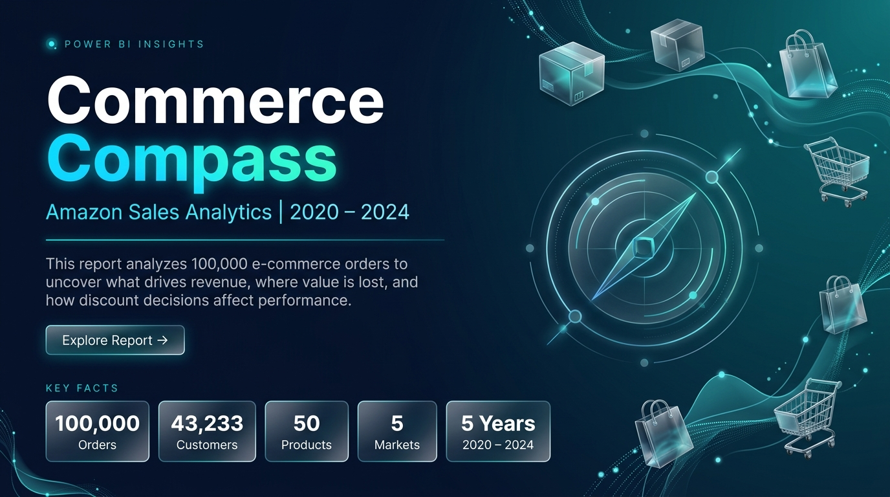
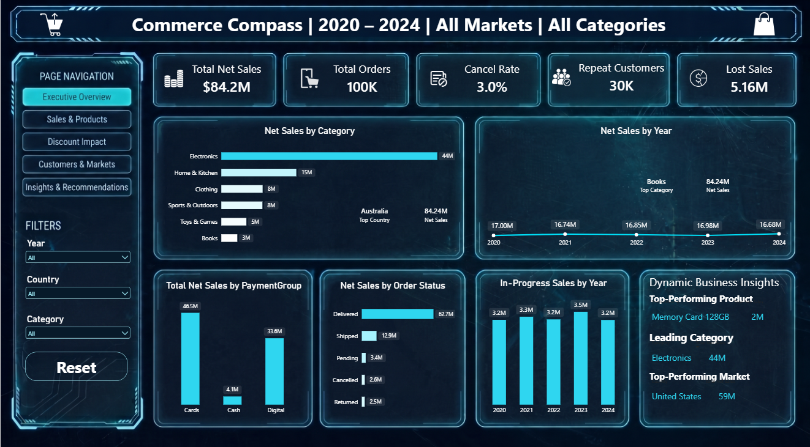
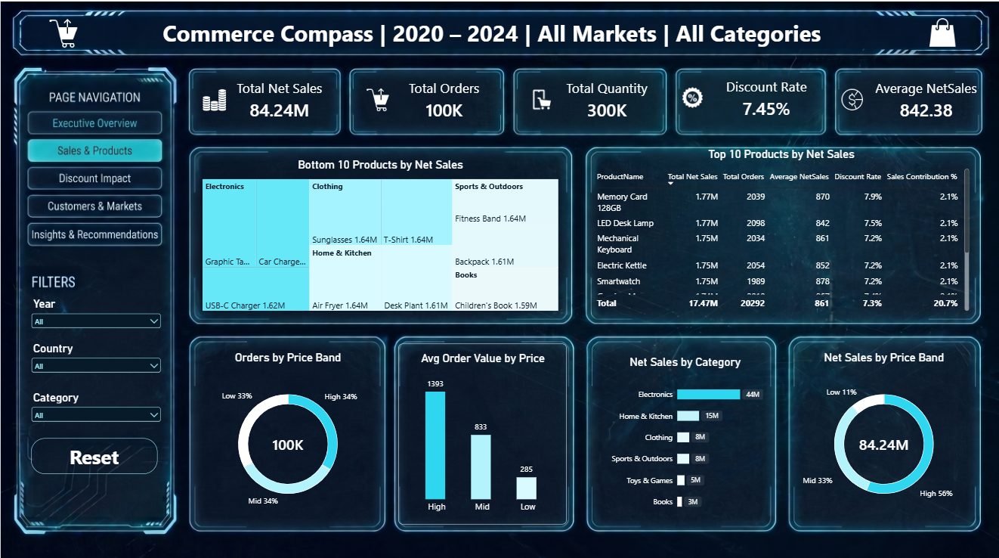
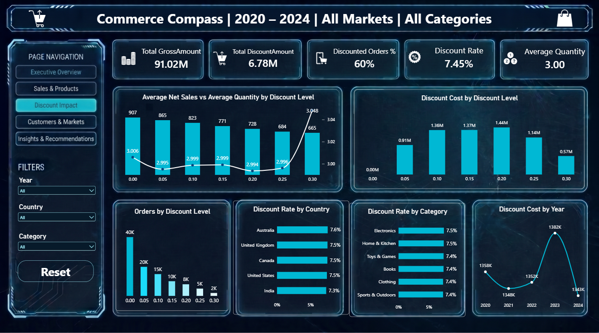
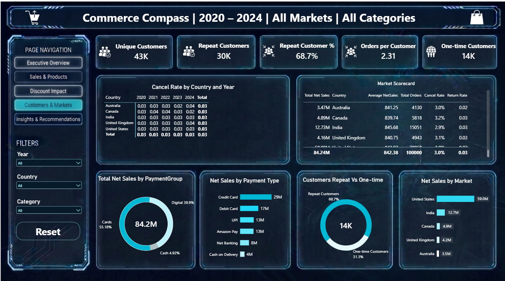
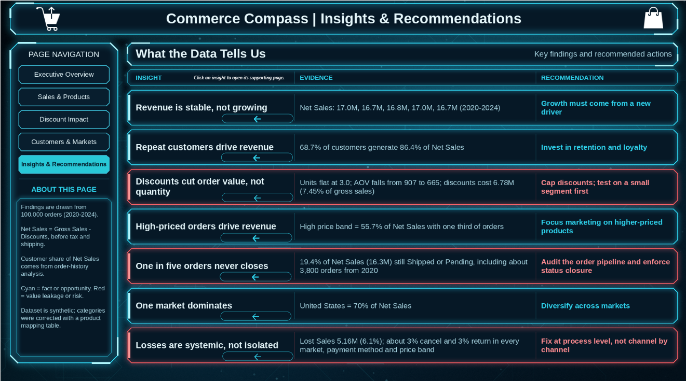

# Commerce Compass: Power BI Dashboard

**An interactive, multi-page Power BI dashboard that analyzes 100,000 e-commerce orders (2020 - 2024). It shows what drives revenue, where value is lost, and how discounts affect performance.**

Built for the **Digital Egypt Pioneers Initiative (DEPI)**.

---

## Table of Contents

1. [Overview](#overview)
2. [Dashboard at a Glance](#dashboard-at-a-glance)
3. [Pages](#pages)
4. [Key Insights](#key-insights)
5. [Interactivity](#interactivity)
6. [Visual Design](#visual-design)
7. [Key Definitions](#key-definitions)
8. [Reading Notes](#reading-notes)
9. [Folder Contents](#folder-contents)
10. [How to Open the Dashboard](#how-to-open-the-dashboard)

---

## Overview

Commerce Compass is designed for management. Each page answers one business question, and the last page turns the findings into actions.

| Page | Business question |
|---|---|
| Executive Overview | How is the business performing? |
| Sales & Products | What drives revenue? |
| Discount Impact | Do discounts help or hurt? |
| Customers & Markets | Who are the customers, and where are they? |
| Insights & Recommendations | What should we do? |

---

## Dashboard at a Glance

| | |
|---|---|
| Period | 2020 - 2024 |
| Orders analyzed | 100,000 |
| Customers / Products / Markets | 43,233 / 50 / 5 |
| Pages | 6 visible + 2 hidden (Product Details drill-through, Tooltip) |
| Filters | Year, Country, Category (shared across the analysis pages) |
| Headline figures | Net Sales 84.24M, Average order value 842, Discount rate 7.45% |

---

## Pages

### 1. Welcome
Landing page with the project title, a short description, headline facts (orders, customers, products, markets), a guide to what each page contains, and a data note.



### 2. Executive Overview
*How is the business performing?*

- **Dynamic title:** the header changes with the filters and shows the selected year, country, and category (for example, "Commerce Compass | 2023 | Canada | Electronics").
- **KPI cards:** Net Sales, Orders, Cancel Rate, Repeat Customers, Lost Sales.
- **Charts:** Net Sales by category, Net Sales by year, Net Sales by order status, and in-progress sales by year.
- **Key Insights block:** a dynamic block that shows the top product, the top country, and the top category by Net Sales. It updates with the filters, so selecting a year or a market changes the answers.
- **Measures used:** Total Net Sales, Total Orders, Cancel Rate, Repeat Customers, Lost Sales, In Progress Sales.



### 3. Sales & Products
*What drives revenue?*

- **KPI cards:** Net Sales, Orders, Quantity, Discount Rate, Average Order Value.
- **Products:** Top 10 and Bottom 10 products by Net Sales, plus a treemap of Net Sales by category and product.
- **Price bands:** orders and Net Sales by price band (donuts), and average order value by price band (Low 285, Mid 833, High 1,393).
- **Measures used:** Total Net Sales, Total Orders, Total Quantity, Discount Rate, Average NetSales.
- **Takeaway:** the best and weakest products are within about 10% of each other, so there is no hero product, while the High price band generates 55.7% of Net Sales with one third of orders.



### 4. Discount Impact
*Do discounts help or hurt?*

- **KPI cards:** Gross Sales, Total Discounts, Discount Rate, Discounted Orders %, Average Quantity.
- **Charts:** order value versus quantity by discount level, discount cost by discount level, orders by discount level, and discount rate by category, country, and year.
- **Measures used:** Total GrossAmount, Total DiscountAmount, Discount Rate, Discounted Orders %, Average Quantity, Average NetSales.
- **Takeaway:** deeper discounts lower the average order value (907 at no discount, 665 at 30%) while units per order stay near 3.0.



### 5. Customers & Markets
*Who are the customers, and where are they?*

- **KPI cards:** Customers, Repeat Customers, One-time Customers, Repeat Rate, Orders per Customer.
- **Charts:** repeat versus one-time customers, Net Sales by country and by payment method, and a market scorecard (Net Sales, orders, average order value, cancel and return rates).
- **Measures used:** Unique Customers, Repeat Customers, One-time Customers, Repeat Customer %, Orders per Customer, Country Sales Contribution %, Payment Sales Contribution %, Cancel Rate, Return Rate.
- **Takeaway:** 68.7% of customers are repeat buyers, and the United States generates 70% of Net Sales.



### 6. Insights & Recommendations
*What should we do?*

Seven findings, each with its evidence and a recommended action. Every row is a button that opens the page that supports the finding. Rows in red mark value leakage or risk, and rows in cyan mark facts or opportunities.



### Hidden pages

| Page | Type | Purpose |
|---|---|---|
| Product Details | Drill-through | Right-click a product to open a page dedicated to it |
| Tooltip | Tooltip page | Quick facts (orders, average order value, discount rate, return rate) shown when hovering over supported charts |

**Product Details (drill-through)**
- **Dynamic header:** two cards at the top show the name of the selected product and its category.
- **KPI cards:** Net Sales, orders, average order value, discount rate, and return rate for that product.
- **Back button** returns to the page the user came from.

---

## Key Insights

| # | Insight | Evidence | Recommendation |
|---|---|---|---|
| 1 | Revenue is stable, not growing | Net Sales: 17.0M, 16.7M, 16.8M, 17.0M, 16.7M (2020 - 2024) | Growth must come from a new driver |
| 2 | Repeat customers drive revenue | 68.7% of customers generate 86.4% of Net Sales | Invest in retention and loyalty |
| 3 | Discounts cut order value, not quantity | Units flat at 3.0; average order value falls from 907 to 665; discounts cost 6.78M (7.45% of gross sales) | Cap discounts and test on a small segment first |
| 4 | High-priced orders drive revenue | High price band = 55.7% of Net Sales with one third of orders | Focus marketing on higher-priced products |
| 5 | One in five orders never closes | 19.4% of Net Sales (16.3M) is still Shipped or Pending, including about 3,800 orders from 2020 | Audit the order pipeline and enforce status closure |
| 6 | One market dominates | United States = 70% of Net Sales | Diversify across markets |
| 7 | Losses are systemic, not isolated | Lost Sales 5.16M (6.1%); about 3% cancelled and 3% returned in every market, payment method, and price band | Fix at process level, not channel by channel |


---

## Interactivity

| Feature | What it does |
|---|---|
| Dynamic title | The header shows the selected year, country, and category |
| Shared filters | Year, Country, and Category slicers apply across the analysis pages, with a Reset button |
| Page navigator | A vertical navigator on every page |
| Key Insights block | Top product, top country, and top category update with the filters |
| Drill-through | From a product to the Product Details page, with a Back button |
| Tooltip page | Quick-facts card on hover |
| Insight buttons | Each insight on the Insights page opens the page that supports it |

---

## Visual Design

A dark, HUD-style theme with custom page backgrounds. Color carries meaning: cyan for facts and opportunities, red for losses and risks.

| Element | Value |
|---|---|
| Canvas | 16:9 |
| Background navy | `#071C2E` |
| Primary accent (cyan) | `#2FD6F0` |
| Secondary accent (teal) | `#0E7C90` |
| Text | `#E6F7FB` |
| Risk / loss (red) | `#FF5A5F` |

Design principles:
- One business question per page, with an insight-style subtitle under each chart.
- Different chart types for different questions: bars for comparisons, lines for trends, donuts for shares of a whole, a matrix or table for detail, a treemap for composition.
- Consistent number formats: millions for money, one decimal for rates, thousands separators for counts.

---

## Key Definitions

| Term | Definition |
|---|---|
| Net Sales | Gross sales minus discounts, before tax and shipping. This is the revenue figure used across the report |
| Total Revenue | Total amount charged to customers, including tax and shipping |
| Average order value | Net Sales divided by the number of orders |
| Discount Rate | Discount amount divided by gross amount (weighted, not a simple average) |
| In Progress | Net Sales of orders that are Shipped or Pending |
| Lost Sales | Net Sales of orders that are Cancelled or Returned |
| Repeat customer | A customer with two or more orders in the selected period |

---

## Reading Notes

- The dataset is synthetic, and many results are flat: no seasonality, similar cancel and return rates everywhere, and no standout product. The dashboard states these results openly instead of inventing patterns.
- Year-over-year growth is only meaningful when a single year is selected, and it is blank for 2020 (the first year).
- Repeat-customer figures are calculated inside the selected filter context, so they change when a year is selected.
- Differences between categories mostly reflect the number of products in each category (Electronics holds 26 of 50 products), not customer preference.
- In Power BI Desktop, page and insight buttons need **Ctrl + Click**. After publishing to the Power BI Service, a normal click works.

---

## Folder Contents

```
.
├── Final M Project.pbix        # the dashboard
├── screenshots/                 # page screenshots used in this README
│   ├── 01_welcome.png
│   ├── 02_executive_overview.png
│   ├── 03_sales_products.png
│   ├── 04_discount_impact.png
│   ├── 05_customers_markets.png
│   └── 06_insights.png
└── README.md
```

---

## How to Open the Dashboard

1. Download `Final M Project.pbix`.
2. Open it with **Power BI Desktop** (the latest version is recommended).
3. Start on the Welcome page and use the page navigator to move between pages.
4. Use the Year, Country, and Category filters to explore, and right-click a product to drill through to its details.

**Suggested tour:** Welcome, then Executive Overview, Sales & Products, Discount Impact, Customers & Markets, and finally Insights & Recommendations, where each insight links back to the page that supports it.
