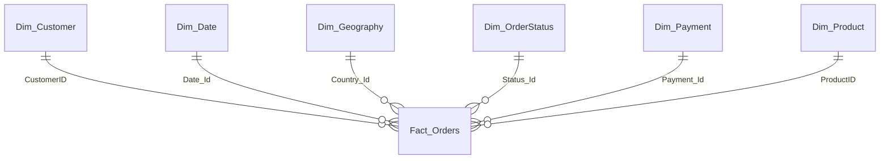

# E-Commerce Analytics: Data Model (Power BI)

This repository documents the data modeling layer of an E-Commerce
analytics project built in Power BI. The model is designed as a Star
Schema to support fast, accurate analysis of sales, customers, products,
countries, payments, and order status.

## Overview

-   **Tool:** Power BI Desktop (Model view)
-   **Schema:** Star Schema
-   **Structure:** 1 fact table + 6 dimension tables
-   **Relationships:** all one-to-many (1:\*) , from each dimension to
    the fact table

## Model view

Add a screenshot of the Power BI Model view at `images/model-view.png`.

## Model Diagram

## Fact Table: Fact_Orders

Stores the measurable business events (one row per order record).

  -----------------------------------------------------------------------
  Type                                Columns
  ----------------------------------- -----------------------------------
  Keys                                Country_Id, CustomerID, Date_Id,
                                      Payment_Id, ProductID, Status_Id,
                                      SellerID, OrderID

  Measures                            Quantity, UnitPrice, GrossAmount,
                                      Discount, DiscountAmount, NetSales,
                                      Tax, ShippingCost, TotalAmount

  Descriptive                         PriceBand
  -----------------------------------------------------------------------

## Dimension Tables

  -----------------------------------------------------------------------
  Table                   Columns                 Business question
                                                  answered
  ----------------------- ----------------------- -----------------------
  Dim_Customer            CustomerID,             Who are our customers
                          CustomerType,           and what type are they?
                          OrderCount              

  Dim_Date                Date_Id, OrderDate      When were the orders
                                                  placed?

  Dim_Geography           Country_Id, Country     Which countries
                                                  generate sales?

  Dim_OrderStatus         Status_Id, OrderStatus, What is the status of
                          StatusGroup             each order?

  Dim_Payment             Payment_Id,             How do customers pay?
                          PaymentMethod,          
                          PaymentGroup            

  Dim_Product             ProductID, ProductName, What do we sell?
                          Category                
  -----------------------------------------------------------------------

## Relationships

  From (dimension, "1" side)     To (fact, "\*" side)
  ------------------------------ ---------------------------
  Dim_Customer\[CustomerID\]     Fact_Orders\[CustomerID\]
  Dim_Date\[Date_Id\]            Fact_Orders\[Date_Id\]
  Dim_Geography\[Country_Id\]    Fact_Orders\[Country_Id\]
  Dim_OrderStatus\[Status_Id\]   Fact_Orders\[Status_Id\]
  Dim_Payment\[Payment_Id\]      Fact_Orders\[Payment_Id\]
  Dim_Product\[ProductID\]       Fact_Orders\[ProductID\]

Filters flow from each dimension to the fact table, so selecting a
country, category, or date range filters every measure consistently.

## Why a Star Schema?

-   **Performance:** simple joins and fast queries.
-   **No redundancy:** customer and product attributes are stored once.
-   **Ease of use:** straightforward DAX measures, slicers, and filters.
-   **Scalability:** new dimensions can be added without restructuring
    the model.

## Possible Next Steps

-   Add a `Dim_Seller` dimension for `SellerID`.
-   Build DAX measures on top of the model (total sales, average order
    value, discount rate).
-   Develop dashboards for sales, customers, products, geography,
    payments, and order status.

## Usage

1.  Open the `.pbix` file in Power BI Desktop.
2.  Go to Model view to inspect tables and relationships.
3.  Use the model as the foundation for report pages and DAX measures.
